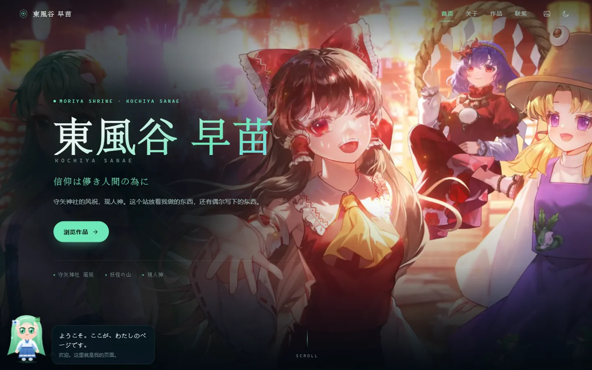
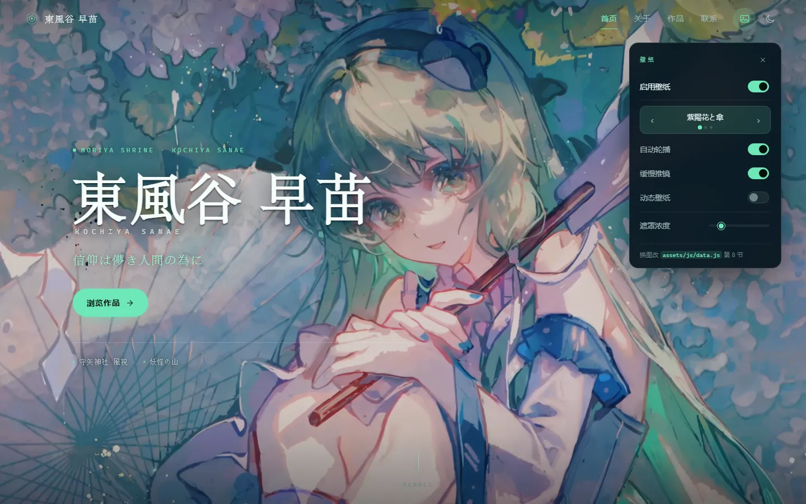

# 東風谷 早苗 · 个人站点

一个**纯静态**的个人主页：没有框架、没有构建步骤、没有依赖。
双击 `index.html` 就能在浏览器里打开，扔到 GitHub Pages 上就能给别人看。

**深色 / 浅色两套皮肤**（右上角切换，会记住你的选择）：

| 夜 · 深色 | 晨 · 浅色 |
|---|---|
|  |  |

| 守矢の祭（壁纸轮播第 3 张） | 壁纸面板 |
|---|---|
|  |  |

`preview/` 里还有作品区、关于页、手机版和左下角 Q 版小人的截图 —— **这个文件夹可以直接删掉**，它不参与网站运行。

---

## 30 秒上手

| 我想…… | 改哪里 |
|---|---|
| 换掉全部文字、作品、文章 | `assets/js/data.js` ← **只需要这一个文件** |
| 换背景图 / 背景视频 | `assets/js/data.js` 最下面的 `WALLPAPER` |
| 换配色 / 字体 / 圆角 | `assets/css/style.css` 顶部的 `:root` |
| 换网站图标 | `assets/img/favicon.svg` |
| 改页面结构（加一个新区块） | `index.html` + `app.js` |

> 改完直接刷新浏览器。**不需要安装任何东西，不需要 npm。**

---

## 目录结构

```
sanae-site/
├── index.html                 页面骨架（一次写定，基本不用动）
├── 404.html                   找不到页面时显示的
├── .nojekyll                  给 GitHub Pages 看的（别删）
├── README.md                  这份说明
├── preview/                   预览截图（可删，不参与运行）
├── tools/
│   ├── add-wallpaper.ps1      把新图批量切成三档尺寸 + 生成 LQIP 的工具
│   ├── shot.mjs               截图 / 抓 JS 报错的工具（用 CDP 驱动 Chrome）
│   └── check.mjs              在页面里跑一段 JS 断言并打印结果（改完自查用）
└── assets/
    ├── css/
    │   └── style.css          全部样式（约 2100 行，带目录注释）
    ├── js/
    │   ├── data.js            ★ 全站内容：站点信息 / 关于 / 作品 / 文章 / 动向 / 联系 / 壁纸
    │   ├── markdown.js        迷你 markdown 渲染器（文章正文用）
    │   ├── sky.js             背景动效：星空、风粒子、鼠标光晕
    │   ├── wallpaper.js       壁纸引擎：轮播、推镜、视频、遮罩
    │   ├── wallpaper-extra.js 额外壁纸清单（由 tools/add-wallpaper.ps1 生成）
    │   ├── chibi.js           ★ 左下角 Q 版小人（手绘 SVG + 台词）
    │   └── app.js             渲染与交互：导航、主题、筛选、阅读器
    ├── img/
    │   ├── favicon.svg        网站图标
    │   └── wallpaper/         壁纸（三档尺寸 webp + 头像）
    └── video/
        ├── hydrangea-loop-720.mp4   动态壁纸（1280×720，382KB）
        ├── hydrangea-loop-poster.webp
        └── source/                  原始 4K 素材留档（14.8MB，不参与加载）
```

页面上的每一个字都来自 `data.js`，`index.html` 里只有结构。这是刻意的：**你不需要在 HTML 里找文字。**

---

## 一、站点基本信息

打开 `assets/js/data.js`，第一段就是：

```js
window.SITE = {
  nameJp:      "東風谷 早苗",      // 大标题（汉字）
  nameEn:      "KOCHIYA SANAE",   // 大标题下面那行（大写英文）
  tagline:     "奇跡は、信じる者の手の中に。",  // 副标题
  heroDesc:    "现人神兼风祝。……",  // 首屏那段介绍
  pageTitle:   "……",              // 浏览器标签页的标题
  description: "……",              // 分享到社交平台时显示的摘要
  heroMeta:    ["現人神 · 風祝", "守矢神社", "Since 2024"],  // 首屏底部小字
  facts: [ { k: "所在地", v: "…" }, … ]   // 「关于」页右侧的表格
};
```

改字符串就行。`heroMeta` 和 `facts` 是数组，增删一项 = 增删一行。

### 改邮箱 / 联系方式

**邮箱要改两个地方**，少改一个就会出现「说明里是旧地址、按钮跳到新地址」：

```js
// ① 「联系」区那句说明文字（SITE 里）
contactDesc: "…… 信件请寄 kui_0810@qq.com，我都会认真回。",

// ② 「联系」区的按钮（文件靠后的 window.SOCIAL）
{ label: "邮件", icon: "mail", url: "mailto:kui_0810@qq.com" },
```

`SOCIAL` 里每一项就是一颗按钮，`icon` 可选 `github` / `x` / `mail` / `bilibili` / `rss` / `link`。
增删一项 = 增删一颗按钮。不需要的（比如还没开通的）直接删掉那一行就不会显示。

---

## 二、文章与动向

> **★ 这两个区块现在是空的。**
>
> `POSTS`、`NOW`、`TIMELINE` 三个数组都被清空了，所以页面上**看不到「文章」和「动向」**
> —— 不是坏了，是故意的：**数组为空时整块自动收起**，连导航里的入口、首屏的「读点文章」
> 按钮一起收起，剩下的区块编号自动重排。
>
> 现在页面上是：**01 关于 · 02 作品 · 03 联系**（导航 4 项）。
>
> 往下面的数组里加回内容、刷新页面，**一切自动恢复，不需要改任何代码**。
> 这段逻辑在 `app.js` 的 `syncSections()`（约 55 行，看注释就懂）。

### 加一篇文章

在 `data.js` 里找到 `window.POSTS = [ ... ]`，**在最前面**加一段：

```js
{
  slug: "my-new-post",              // 唯一标识，不能和别人重复
  title: "文章标题",
  date: "2026-07-01",               // 排序就靠它，格式必须是 YYYY-MM-DD
  tags: ["随笔"],                    // 列表和阅读器里的小标签，可以空数组
  excerpt: "列表里显示的一句话。",     // 不写的话会自动从正文截取
  body: `
    正文从这里开始，用 markdown 写。

    ## 小标题

    **粗体**、*斜体*、\`行内代码\`、[链接](https://example.com)。

    - 列表项
    - 列表项

    > 引用

    代码块请用 4 个空格缩进：

        console.log('hello');
  `
}
```

### 关于 markdown

支持：`# 标题`、`**粗体**`、`*斜体*`、`` `代码` ``、`[链接](url)`、``、
`- 列表`、`1. 有序`、`> 引用`、`---` 分隔线、表格、代码块。

**不支持**：HTML 内嵌、脚注、嵌套列表。故意的 —— 少一个能力，少一堆问题。

### ⚠️ 代码块为什么用缩进

因为正文写在 JS 的模板字符串（反引号包裹）里，如果你想用三个反引号做代码块，得写成
`` \`\`\` `` —— 很丑。**用 4 个空格缩进更省事。**

想让某篇文章可以被链接直接打开，在网址后面加 `#post-slug`：

```
https://你的域名/#post-my-new-post
```

### 加一条动向

`data.js` 里还有两个数组，都在 `POSTS` 下面：

```js
// 「正在做 / 正在读 / 近期目标」那几张卡片
window.NOW = [
  { label: "正在做", text: "……" },
  { label: "正在读", text: "……" }
];

// 右侧那条竖着的「最近」
window.TIMELINE = [
  { date: "2026.06", text: "做了什么。" },
  { date: "2026.05", text: "做了什么。" }
];
```

- `NOW` 和 `TIMELINE` **都为空** → 「动向」整块收起
- **只填一个也行** —— 页面会自动让剩下那一半占满整行（`.now-grid.is-single`）
- 时间线按你写的顺序显示，**最近的放最前面**（不像文章那样会自动排序，得你自己排）

---

## 三、加一个作品

`data.js` 里的 `window.WORKS = [ ... ]`：

```js
{
  title:    "项目名",
  desc:     "一两句话说明它是什么、解决了什么。",
  category: "开发",        // 会自动变成筛选按钮；写新词就多一个按钮
  tags:     ["React", "开源"],
  status:   "active",      // active 进行中 · wip 半成品 · archived 已归档
  glyph:    "code",        // 图标：code / wind / palette / book / spark / archive
  links: [
    { type: "code", label: "源码", url: "https://github.com/你/项目" },
    { type: "demo", label: "在线", url: "https://..." },
    { type: "doc",  label: "文档", url: "..." }
  ]
}
```

`category` 写成什么都行 —— 筛选按钮是从所有作品的 `category` 自动去重生成的。

---

## 四、换壁纸 / 换背景 ★

首页现在是**真图壁纸**：三张从 4K 视频里抽出来的静帧轮播，外加一段 382KB 的循环视频。

> 注意：壁纸**只在首屏出现**。往下滚它会自动淡回内置的 SVG 神社夜景（山川、鸟居、星空、风粒子），
> 所以正文永远不会压在照片上。这是设计，不是 bug。

### 4.1 目前有哪三张

在 `data.js` **第 8 节** `window.WALLPAPER`：

```js
window.WALLPAPER = {
  enabled:  true,     // 默认是否开壁纸
  interval: 14000,    // 自动轮播间隔（毫秒）
  kenBurns: true,     // 缓慢推镜
  scrim:    0.55,     // 遮罩浓度 0~1，越大字越清楚、画面越暗

  live: {             // 动态壁纸（视频）
    video:  "assets/video/hydrangea-loop-720.mp4",
    poster: "assets/video/hydrangea-loop-poster.webp",
    title:  "紫陽花と傘 · 動"
  },

  slides: [ /* 三张图 */ ]
};
```

| 内部名 | 面板上显示 | 内容 |
|---|---|---|
| `hydrangea` | 紫陽花と傘 | 紫藤/紫阳花下撑纸伞的早苗（整幅） |
| `hydrangea-detail` | 紫陽花と傘 · 寄 | 同一张的**脸部特写** |
| `festival` | 守矢の祭 | 祭典夜景：早苗 / 灵梦 / 帕秋莉 / 洩矢谅子 |

页面右上角那个**图片图标**就是壁纸面板，可以实时切图、关轮播、开视频、拖遮罩浓度，
你的选择会记在浏览器里（换台设备不继承）。

### 4.2 加一张新壁纸（推荐用脚本）

```powershell
# 1. 把图片丢进去
copy 你的图.jpg assets\img\wallpaper\

# 2. 在站点根目录跑
powershell -ExecutionPolicy Bypass -File tools\add-wallpaper.ps1
```

脚本会替你做四件事：按 16:9 居中裁出 **640 / 1280 / 2560** 三档 webp、
生成一张 24px 的模糊占位图（首屏秒出，不用等大图）、
把清单写进 `assets/js/wallpaper-extra.js`，刷新就能在面板里看到。

- 已经切好的文件（`xxx-640.webp` 这种）、`avatar-*`、`*-lqip.*` 会被自动跳过，**重复跑是安全的**
- 需要 ImageMagick：<https://imagemagick.org/script/download.php#windows>（本机已装 7.1.2）
- 这个 `.ps1` 是 **UTF-8 带 BOM** 的。如果你用别的编辑器改它，**务必保持 BOM**，否则 PowerShell 5.1 读中文会乱码报语法错

### 4.3 手动加（不想用脚本）

在 `slides` 数组里加一项，两种写法任选：

```js
// ① 已经切好尺寸的
{ base: "assets/img/wallpaper/my-photo", sizes: [640, 1280, 2560], title: "我的图" }

// ② 就一张普通图片
{ src: "assets/img/wallpaper/my-photo.jpg", title: "我的图" }
```

每张图还能加三个可选字段：

| 字段 | 作用 |
|---|---|
| `focal` | 裁剪焦点，如 `"52% 40%"`。**竖屏时**决定保留哪一块——想让人脸在手机上也居中，就调这个 |
| `boost` | 遮罩倍率。画面越亮越花就调大（祭典那张是 1.18），越暗调越小 |
| `lqip` | 模糊占位图（`data:image/webp;base64,...`） |

### 4.4 换成动态壁纸（视频）

`live.video` 指向的 `hydrangea-loop-720.mp4` 是**从 4K 母带压出来的**：
1280×720、H.264、5.36 秒、**382 KB**（原片 14.78 MB，压了 39 倍）。
原始 4K 文件留在 `assets/video/source/`，只是留档，**不参与页面加载**。

`live` 默认是**关**的（面板里的「动态壁纸」开关），因为它是可选的重资源。
想换自己的视频，压到 720p / 5MB 以内，改 `live.video` 和 `live.poster` 即可。

### 4.5 素材建议

| | 建议 |
|---|---|
| 图片体积 | 单张 **250 KB 以内**（现在三张的 2560 档在 200～240 KB） |
| 图片格式 | `webp` 优先，`jpg` 也行 |
| 视频体积 | **5 MB 以内**；循环的话首尾要能接上 |
| 视频时长 | 5～15 秒足够 |
| 画面要求 | 左侧要**偏暗、干净**——标题和正文都在那一侧 |

### 4.6 字看不清怎么办

按顺序试这三招：

1. 面板里把**遮罩浓度**往右拖
2. 给那一张图加 `boost: 1.2`
3. 改 `assets/css/style.css` 里 `.scene-scrim` 的系数（那三层分别是
   「标题后方的径向暗斑 / 左缘渐变 / 上下渐晕」）

手机上遮罩是**另一套规则**（`style.css` 第 15 节）：桌面是「左侧一团暗」，手机换成「上薄下厚」的竖向渐变，
因为手机正文铺满整行且偏下。

---

## 五、换配色和字体

`assets/css/style.css` 最上面有一块 `:root`，是全站的调色板：

```css
:root {
  --bg:        #050d12;   /* 背景 */
  --text:      #e8f4f1;   /* 正文 */
  --text-dim:  #9fb9b7;   /* 次要文字 */
  --accent:    #6ee7b7;   /* 主强调色（薄荷绿） */
  --accent-2:  #7dd3fc;   /* 次强调色（天蓝） */
  --gold:      #f3d9a4;   /* 警示/半成品标签 */
  ...
}
```

**只要改这几个变量，全站配色就变了** —— 不用去翻具体组件。

浅色模式在紧接着的 `[data-theme="light"] { ... }` 里，同样改那一组。

换字体改 `--font-display`（标题）、`--font-body`（正文）、`--font-mono`（代码/小字）。

> ⚠️ 深色主题的两条经验，写在这里免得你再踩：
> 1. **别用纯黑 `#000` 配纯白 `#fff`** —— 对比度 21:1，看久了眼睛疼。用带一点色的近黑近白（现在这样就是）。
> 2. **阴影在深色底上几乎看不见**，深色主题应该用「发光」（带颜色的 `box-shadow`）表达层次。

---

## 六、部署到 GitHub Pages

### 方式 A：网页操作（最简单，不用命令行）

1. 在 GitHub 上新建一个仓库，名字随意，比如 `sanae-site`，**Public**
   - 如果想让网址是 `https://你的用户名.github.io/`，仓库名必须叫 `你的用户名.github.io`
2. 把整个 `sanae-site` 文件夹里的东西**全部**上传上去
   （网页上 `Add file → Upload files`，把文件夹里的内容拖进去，注意是**里面的内容**，不是外层文件夹）
3. 进仓库 `Settings → Pages`
4. `Source` 选 **Deploy from a branch**，`Branch` 选 **main**，目录选 **/ (root)**，保存
5. 等 1～2 分钟，刷新这个页面，顶上会出现网址

### 方式 B：命令行（推荐，以后更新只要一条命令）

在 `sanae-site` 文件夹里打开终端：

```bash
git init
git add .
git commit -m "first commit"
git branch -M main
git remote add origin https://github.com/你的用户名/你的用户名.github.io.git
git push -u origin main
```

然后去 `Settings → Pages` 选 main 分支 / root，保存。

以后每次改完内容：

```bash
git add .
git commit -m "更新文章"
git push
```

**大约 1 分钟后线上就更新了。**

### 绑定自己的域名（可选）

1. 在仓库根目录新建文件 `CNAME`，内容只有一行（不要 http://）：`你的域名.com`
2. 去你的域名服务商，加一条 `CNAME` 记录指向 `你的用户名.github.io`
3. 回 `Settings → Pages`，填上域名，勾选 `Enforce HTTPS`

---

## 七、本地预览

- **直接双击 `index.html`** —— 就能看，所有功能都正常（因为这个站没有任何网络请求）
- 想要一个 `http://localhost` 的地址：在这个文件夹里执行
  ```bash
  python -m http.server 8000
  ```
  然后打开 `http://localhost:8000`

---

## 八、常见问题

**Q：文章 / 动向怎么不见了？**
`data.js` 里 `POSTS` / `NOW` / `TIMELINE` 是空数组。**空就不显示**，这是设计（见第二节）。
加回内容刷新就回来了。

**Q：改了 `data.js` 刷新没变化？**
浏览器缓存。`Ctrl + F5` 强制刷新。

**Q：中文变成乱码了？**
你的编辑器把文件存成了 GBK。**必须存成 UTF-8**（VSCode 右下角可以点编码切换，选 `Save with Encoding → UTF-8`）。

**Q：文章里能不能直接写 markdown 文件（.md）？**
不能，也不打算支持 —— 读 `.md` 需要 `fetch`，而双击 `index.html` 时（`file://` 协议）
浏览器会拒绝这个请求。现在的方式「双击就能看」，比「必须开服务器」重要。

**Q：为什么没有评论？**
故意的。想说的话发邮件，我会认真回。

**Q：想加访问统计？**
在 `index.html` 的 `</body>` 前加一行你统计服务给的脚本就行（如 Umami、Plausible）。
不建议用需要弹 Cookie 同意框的那种。

**Q：手机上菜单打不开？**
宽度小于 820px 时右上角会出现汉堡按钮。如果不见，检查 `app.js` 里 `#navToggle` 是否被删了。

**Q：想加 RSS？**
静态站加 RSS 需要手工维护一个 `feed.xml`（或写脚本生成）。需要的话说一声，可以加个生成脚本。

---

## 九、关于版权

- 本站是 **东方 Project 的二次创作**。东风谷早苗及相关设定的版权归
  **上海アリス幻樂団 / ZUN** 所有。
- 页面模板（HTML/CSS/JS）与其中的原创文字：你自己决定怎么授权。
- **左下角的 Q 版小人是这个仓库里手绘的 SVG**（`assets/js/chibi.js`），不是网上抓来的图，
  你可以随意改、随意用。
- **壁纸（`assets/img/wallpaper/` 与 `assets/video/`）来自你桌面的「苗苗网页背景」里那两个
  《哲风壁纸》的东方壁纸视频**，是从 4K 母带抽帧/重编码来的。这一点要说清楚：
  - 这些画的**著作权不属于你**，很可能也不属于「哲风壁纸」（壁纸站通常是转搬）；
  - 个人、非商业的东方同人站上挂着，是这个圈子的常态；
  - 但**对外公开发布前，最好在页脚或 README 里注明来源**，并且一旦要做商业化（挂广告、卖东西），
    就得先弄清楚授权 —— 最稳的做法是换成本人画的、或明确 CC 授权的图。
  - `assets/video/source/` 里的两个 4K 母带只是留档（14.8MB / 71.8MB），**不参与页面加载**，
    真上线前建议删掉，省仓库空间。
- 商用前请先确认素材与二次创作的授权范围。

---

## 十、左下角的 Q 版小人

`assets/js/chibi.js`。她是纯手写 SVG（200×260 坐标），所以：

**改台词** —— 文件顶部 `LINES` 数组，加一行就行：

```js
var LINES = [
  { jp: 'ミラクル、起こしてみせます！', cn: '奇迹，就让我来引发给你看！' },
  // 加在这里 ↑
];
```

**改长相** —— 同一个文件里的 `CHIBI_SVG` 字符串，就是普通 SVG：头发 `#7fd6a8`、
衣服 `#3f6fb5`、青蛙发饰 `#66c47c`，搜十六进制直接替换。

**动效** —— `style.css` 第 14 节：待机上下浮（`.ch-bob`）、头发轻摆（`.ch-hair-*`）、
眨眼（`.ch-eye`，靠 `scaleY` 压扁）、闪光（`.ch-sparks`）。系统开了「减少动态效果」会自动全关。

**关掉她** —— 鼠标移到她身上，右上角出现 ×，点掉就不会再出现（记在 `localStorage('sanae.chibi')`）。
想让她回来，F12 控制台执行：

```js
localStorage.removeItem('sanae.chibi'); location.reload();
```

**换地方 / 换大小** —— `style.css` 里 `.chibi { left / bottom }` 和 `.chibi-btn { width }`
（桌面 104px，820px 以下 80px，480px 以下 68px）。

---

## 十一、这套东西的健康状况

为了让它十年后还能打开，刻意守了几条线：

- **零运行时依赖** —— 没有 React、没有 jQuery、没有字体 CDN、没有图标库。
- **零构建步骤** —— 没有 npm install、没有打包、没有版本号腐化。
- **渐进增强** —— JS 挂了，`<noscript>` 会告诉你；CSS 挂了，文字照样能读。
- **内容与表现分离** —— 换内容不用碰 HTML，换样式不用碰 JS。

代价是：加复杂功能（比如全文搜索）要自己写。对一个个人站来说，这个交换是划算的。
