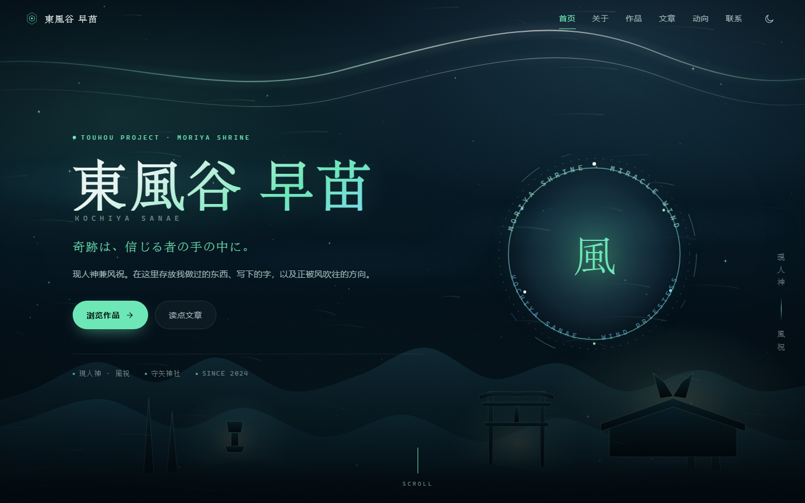
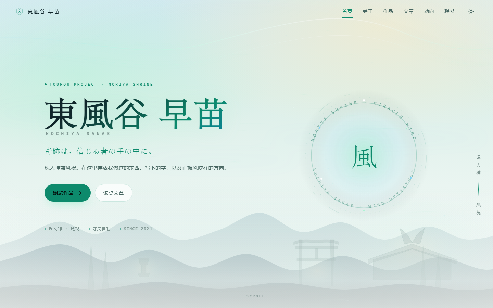

# 東風谷 早苗 · 个人站点

一个**纯静态**的个人主页：没有框架、没有构建步骤、没有依赖。
双击 `index.html` 就能在浏览器里打开，扔到 GitHub Pages 上就能给别人看。

**深色 / 浅色两套皮肤**（右上角切换，会记住你的选择）：

| 夜 · 深色 | 晨 · 浅色 |
|---|---|
|  |  |

`preview/` 里还有作品区、阅读器和手机版的截图 —— **这个文件夹可以直接删掉**，它不参与网站运行。

---

## 30 秒上手

| 我想…… | 改哪里 |
|---|---|
| 换掉全部文字、作品、文章 | `assets/js/data.js` ← **只需要这一个文件** |
| 换背景图 / 背景视频 | `assets/js/data.js` 最下面的 `BACKGROUND` |
| 换配色 / 字体 / 圆角 | `assets/css/style.css` 顶部的 `:root` |
| 换网站图标 | `assets/img/favicon.svg` |
| 改页面结构（加一个新区块） | `index.html` + `app.js` |

> 改完直接刷新浏览器。**不需要安装任何东西，不需要 npm。**

---

## 目录结构

```
sanae-site/
├── index.html                 页面骨架（一次写定，基本不用动）
├── 404.html                   找不到页面时显示的
├── .nojekyll                  给 GitHub Pages 看的（别删）
├── README.md                  这份说明
├── preview/                   预览截图（可删，不参与运行）
└── assets/
    ├── css/
    │   └── style.css          全部样式（约 1500 行，带目录注释）
    ├── js/
    │   ├── data.js            ★ 全站内容：站点信息 / 关于 / 作品 / 文章 / 动向 / 联系 / 背景
    │   ├── markdown.js        迷你 markdown 渲染器（文章正文用）
    │   ├── sky.js             背景动效：星空、风粒子、鼠标光晕
    │   └── app.js             渲染与交互：导航、主题、筛选、阅读器
    └── img/
        └── favicon.svg        网站图标
```

页面上的每一个字都来自 `data.js`，`index.html` 里只有结构。这是刻意的：**你不需要在 HTML 里找文字。**

---

## 一、站点基本信息

打开 `assets/js/data.js`，第一段就是：

```js
window.SITE = {
  nameJp:      "東風谷 早苗",      // 大标题（汉字）
  nameEn:      "KOCHIYA SANAE",   // 大标题下面那行（大写英文）
  tagline:     "奇跡は、信じる者の手の中に。",  // 副标题
  heroDesc:    "现人神兼风祝。……",  // 首屏那段介绍
  pageTitle:   "……",              // 浏览器标签页的标题
  description: "……",              // 分享到社交平台时显示的摘要
  heroMeta:    ["現人神 · 風祝", "守矢神社", "Since 2024"],  // 首屏底部小字
  facts: [ { k: "所在地", v: "…" }, … ]   // 「关于」页右侧的表格
};
```

改字符串就行。`heroMeta` 和 `facts` 是数组，增删一项 = 增删一行。

---

## 二、加一篇文章

在 `data.js` 里找到 `window.POSTS = [ ... ]`，**在最前面**加一段：

```js
{
  slug: "my-new-post",              // 唯一标识，不能和别人重复
  title: "文章标题",
  date: "2026-07-01",               // 排序就靠它，格式必须是 YYYY-MM-DD
  tags: ["随笔"],                    // 列表和阅读器里的小标签，可以空数组
  excerpt: "列表里显示的一句话。",     // 不写的话会自动从正文截取
  body: `
    正文从这里开始，用 markdown 写。

    ## 小标题

    **粗体**、*斜体*、\`行内代码\`、[链接](https://example.com)。

    - 列表项
    - 列表项

    > 引用

    代码块请用 4 个空格缩进：

        console.log('hello');
  `
}
```

### 关于 markdown

支持：`# 标题`、`**粗体**`、`*斜体*`、`` `代码` ``、`[链接](url)`、``、
`- 列表`、`1. 有序`、`> 引用`、`---` 分隔线、表格、代码块。

**不支持**：HTML 内嵌、脚注、嵌套列表。故意的 —— 少一个能力，少一堆问题。

### ⚠️ 代码块为什么用缩进

因为正文写在 JS 的模板字符串（反引号包裹）里，如果你想用三个反引号做代码块，得写成
`` \`\`\` `` —— 很丑。**用 4 个空格缩进更省事。**

想让某篇文章可以被链接直接打开，在网址后面加 `#post-slug`：

```
https://你的域名/#post-my-new-post
```

---

## 三、加一个作品

`data.js` 里的 `window.WORKS = [ ... ]`：

```js
{
  title:    "项目名",
  desc:     "一两句话说明它是什么、解决了什么。",
  category: "开发",        // 会自动变成筛选按钮；写新词就多一个按钮
  tags:     ["React", "开源"],
  status:   "active",      // active 进行中 · wip 半成品 · archived 已归档
  glyph:    "code",        // 图标：code / wind / palette / book / spark / archive
  links: [
    { type: "code", label: "源码", url: "https://github.com/你/项目" },
    { type: "demo", label: "在线", url: "https://..." },
    { type: "doc",  label: "文档", url: "..." }
  ]
}
```

`category` 写成什么都行 —— 筛选按钮是从所有作品的 `category` 自动去重生成的。

---

## 四、换背景（图或视频）★

这是你最可能需要改的地方。在 `data.js` **最下面**：

```js
window.BACKGROUND = {
  bg:      "assets/img/bg.jpg",     // 图片路径
  video:   "assets/img/bg.mp4",     // 视频路径（有视频就优先用视频）
  poster:  "",                       // 视频封面图，可选
  opacity: 1,                        // 0~1 整体强度
  overlay: "auto"                    // "auto" 自动加渐变遮罩 | "none" 不加
};
```

**留空（`""`）就用内置的 SVG 神社场景**（山川、鸟居、星空、风粒子）。

操作步骤：

1. 把图片/视频放进 `assets/img/`（新建子目录也行，比如 `assets/img/bg/`）
2. 在 `BACKGROUND` 里写上相对路径
3. 刷新

### 素材建议

| | 建议 |
|---|---|
| 图片尺寸 | 竖屏手机 1080×1920、横屏 1920×1080 以上，`object-fit: cover` 会自动裁切 |
| 图片格式 | `webp`（体积小）或 `jpg`。整图要**偏暗**或**偏简单**，否则正文看不清 |
| 图片体积 | 控制在 **300 KB** 以内，否则首屏会白一下 |
| 视频格式 | `mp4` / H.264，无音轨（有也会自动静音） |
| 视频体积 | **5 MB 以内**，循环播放的话首尾要能接上 |
| 视频时长 | 8～20 秒足够 |

### 如果图太亮、字看不清

把 `overlay` 保持 `"auto"`（默认会加一层从上到下逐渐变深的遮罩）。

如果 `"auto"` 还不够，去 `assets/css/style.css` 里搜 `.scene-media::after`，
把那段 `linear-gradient` 里的 `.32 / .18 / .86` 调大（越大越暗）。

---

## 五、换配色和字体

`assets/css/style.css` 最上面有一块 `:root`，是全站的调色板：

```css
:root {
  --bg:        #050d12;   /* 背景 */
  --text:      #e8f4f1;   /* 正文 */
  --text-dim:  #9fb9b7;   /* 次要文字 */
  --accent:    #6ee7b7;   /* 主强调色（薄荷绿） */
  --accent-2:  #7dd3fc;   /* 次强调色（天蓝） */
  --gold:      #f3d9a4;   /* 警示/半成品标签 */
  ...
}
```

**只要改这几个变量，全站配色就变了** —— 不用去翻具体组件。

浅色模式在紧接着的 `[data-theme="light"] { ... }` 里，同样改那一组。

换字体改 `--font-display`（标题）、`--font-body`（正文）、`--font-mono`（代码/小字）。

> ⚠️ 深色主题的两条经验，写在这里免得你再踩：
> 1. **别用纯黑 `#000` 配纯白 `#fff`** —— 对比度 21:1，看久了眼睛疼。用带一点色的近黑近白（现在这样就是）。
> 2. **阴影在深色底上几乎看不见**，深色主题应该用「发光」（带颜色的 `box-shadow`）表达层次。

---

## 六、部署到 GitHub Pages

### 方式 A：网页操作（最简单，不用命令行）

1. 在 GitHub 上新建一个仓库，名字随意，比如 `sanae-site`，**Public**
   - 如果想让网址是 `https://你的用户名.github.io/`，仓库名必须叫 `你的用户名.github.io`
2. 把整个 `sanae-site` 文件夹里的东西**全部**上传上去
   （网页上 `Add file → Upload files`，把文件夹里的内容拖进去，注意是**里面的内容**，不是外层文件夹）
3. 进仓库 `Settings → Pages`
4. `Source` 选 **Deploy from a branch**，`Branch` 选 **main**，目录选 **/ (root)**，保存
5. 等 1～2 分钟，刷新这个页面，顶上会出现网址

### 方式 B：命令行（推荐，以后更新只要一条命令）

在 `sanae-site` 文件夹里打开终端：

```bash
git init
git add .
git commit -m "first commit"
git branch -M main
git remote add origin https://github.com/你的用户名/你的用户名.github.io.git
git push -u origin main
```

然后去 `Settings → Pages` 选 main 分支 / root，保存。

以后每次改完内容：

```bash
git add .
git commit -m "更新文章"
git push
```

**大约 1 分钟后线上就更新了。**

### 绑定自己的域名（可选）

1. 在仓库根目录新建文件 `CNAME`，内容只有一行（不要 http://）：`你的域名.com`
2. 去你的域名服务商，加一条 `CNAME` 记录指向 `你的用户名.github.io`
3. 回 `Settings → Pages`，填上域名，勾选 `Enforce HTTPS`

---

## 七、本地预览

- **直接双击 `index.html`** —— 就能看，所有功能都正常（因为这个站没有任何网络请求）
- 想要一个 `http://localhost` 的地址：在这个文件夹里执行
  ```bash
  python -m http.server 8000
  ```
  然后打开 `http://localhost:8000`

---

## 八、常见问题

**Q：改了 `data.js` 刷新没变化？**
浏览器缓存。`Ctrl + F5` 强制刷新。

**Q：中文变成乱码了？**
你的编辑器把文件存成了 GBK。**必须存成 UTF-8**（VSCode 右下角可以点编码切换，选 `Save with Encoding → UTF-8`）。

**Q：文章里能不能直接写 markdown 文件（.md）？**
不能，也不打算支持 —— 读 `.md` 需要 `fetch`，而双击 `index.html` 时（`file://` 协议）
浏览器会拒绝这个请求。现在的方式「双击就能看」，比「必须开服务器」重要。

**Q：为什么没有评论？**
故意的。想说的话发邮件，我会认真回。

**Q：想加访问统计？**
在 `index.html` 的 `</body>` 前加一行你统计服务给的脚本就行（如 Umami、Plausible）。
不建议用需要弹 Cookie 同意框的那种。

**Q：手机上菜单打不开？**
宽度小于 820px 时右上角会出现汉堡按钮。如果不见，检查 `app.js` 里 `#navToggle` 是否被删了。

**Q：想加 RSS？**
静态站加 RSS 需要手工维护一个 `feed.xml`（或写脚本生成）。需要的话说一声，可以加个生成脚本。

---

## 九、关于版权

- 本站是 **东方 Project 的二次创作**。东风谷早苗及相关设定的版权归
  **上海アリス幻樂団 / ZUN** 所有。
- 页面模板（HTML/CSS/JS）与其中的原创文字：你自己决定怎么授权。
- 背景图 / 视频请**只使用你有权使用的素材** —— 自己拍的、自己画的，或者明确可商用的
  （CC0 / Unsplash / Pexels）。别人的同人图**不要**直接拿来当背景。
- 商用（挂广告、卖东西）前请先确认素材与二次创作的授权范围。

---

## 十、这套东西的健康状况

为了让它十年后还能打开，刻意守了几条线：

- **零运行时依赖** —— 没有 React、没有 jQuery、没有字体 CDN、没有图标库。
- **零构建步骤** —— 没有 npm install、没有打包、没有版本号腐化。
- **渐进增强** —— JS 挂了，`<noscript>` 会告诉你；CSS 挂了，文字照样能读。
- **内容与表现分离** —— 换内容不用碰 HTML，换样式不用碰 JS。

代价是：加复杂功能（比如全文搜索）要自己写。对一个个人站来说，这个交换是划算的。
